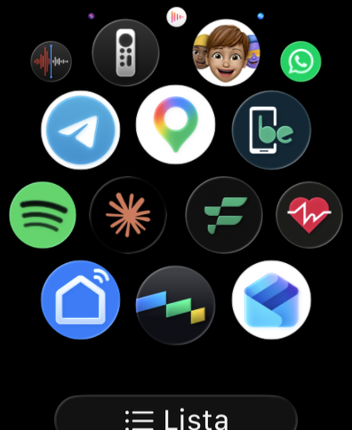
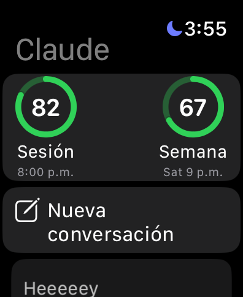
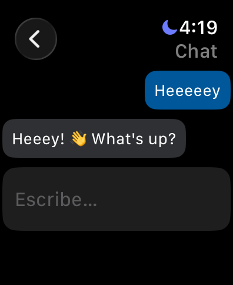

# claude-watchOS

Chat with Claude from your Apple Watch on your Claude subscription (Pro/Max), with no API key.

The watch app talks to a tiny relay server that runs headless Claude Code (`claude -p`) on a machine you own: your Mac, or a Linux box in your homelab.

```
Apple Watch app ──HTTPS (Tailscale Funnel) or LAN──▶ host: server/server.ts ──▶ claude -p --resume <id>
```

<p>
  
  
  
</p>

## Features

- Chat from the watch keyboard, Scribble or dictation.
- Conversation history: every conversation is stored on the host (`server/session/history/`) and can be reopened and continued.
- Remaining subscription usage (5-hour session and weekly) with reset times, read from Claude Code's own login.

## Chat only, by design

The relay runs Claude Code with **all tools disabled** (`--tools ""`, no MCP servers, no settings) and a plain chat system prompt.
Claude can answer questions, but it cannot run commands, read files or change anything on the host, even if someone gets your token.

## Requirements

- **Host** (the machine running the relay): Claude Code logged in to a Claude subscription, and Node 24+. macOS or Linux.
- **Build Mac**: Xcode and [XcodeGen](https://github.com/yonaskolb/XcodeGen), to install the watch app.
- **Apple Watch** with Developer Mode on. If Xcode does not list the watch, check that the Mac's **Bluetooth** is on.

## Layout

```
server/                    Node relay (no dependencies)
  server.ts                HTTP routes, auth (composition root)
  claude-cli.ts            Runs `claude -p` and serializes calls
  conversation-store.ts    Conversation history as JSON files
  usage-client.ts          Subscription usage from the OAuth usage endpoint
watch/                     watchOS app (SwiftUI), project generated by XcodeGen
  project.yml
  WatchChat/               Views, view models, models and ChatService
setup.sh                   Creates the token and watch/WatchChat/Config.swift, generates the Xcode project
```

## Setup

1. Pick how the watch reaches the host (the watch cannot run a VPN, so it needs a public URL or the same LAN):
   - **Anywhere (Tailscale Funnel):** on the host, install Tailscale, log in and run `tailscale funnel --bg 8787`. Server URL: `https://<host>.<tailnet>.ts.net`.
   - **LAN only:** server URL `http://<host-lan-ip>:8787`, and start the server with `HOST=0.0.0.0`.
2. On the build Mac, run `./setup.sh <server-url>`. It creates `server/token.txt` and `watch/WatchChat/Config.swift` (both git-ignored) and generates `watch/WatchChat.xcodeproj`.
   The signing team is taken from `$DEVELOPMENT_TEAM` or, if unset, from your "Apple Development" certificate.
3. If the host is another machine, copy `server/` there, including `token.txt`.
4. Start the relay on the host: `cd server && node server.ts` (or `HOST=0.0.0.0 node server.ts` for LAN).
5. Open `watch/WatchChat.xcodeproj`, pick your watch and Run.
   With a free Apple ID the app expires after 7 days; run it again from Xcode.

## Running the relay on a MacBook

A MacBook sleeps when the lid closes. To keep it awake: `sudo pmset -a disablesleep 1`, and undo it with `sudo pmset -a disablesleep 0`.
It needs internet (for example an iPhone hotspot) and gets warm in a closed bag. An always-on homelab host avoids this.

## Server API (Bearer token)

- `POST /chat` `{text, conversationId?}` → `{reply, conversationId}`
- `GET /conversations`, `GET /conversations/:id`
- `GET /usage` → `{session, weekly}` with `usedPercent` and `resetsAt`

## Disclaimer

Personal project, not affiliated with or endorsed by Anthropic or Apple. It drives your own Claude Code login for your own use; use it within Claude's terms of service.

## License

[MIT](LICENSE)
